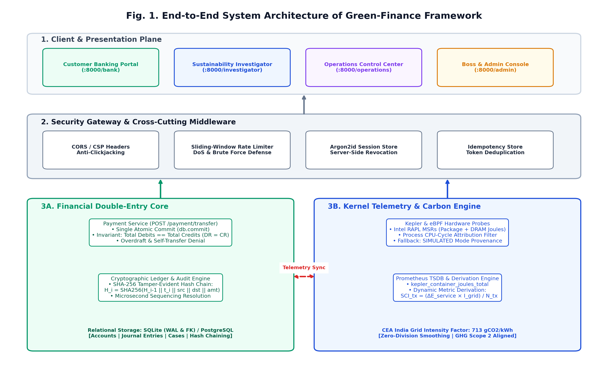
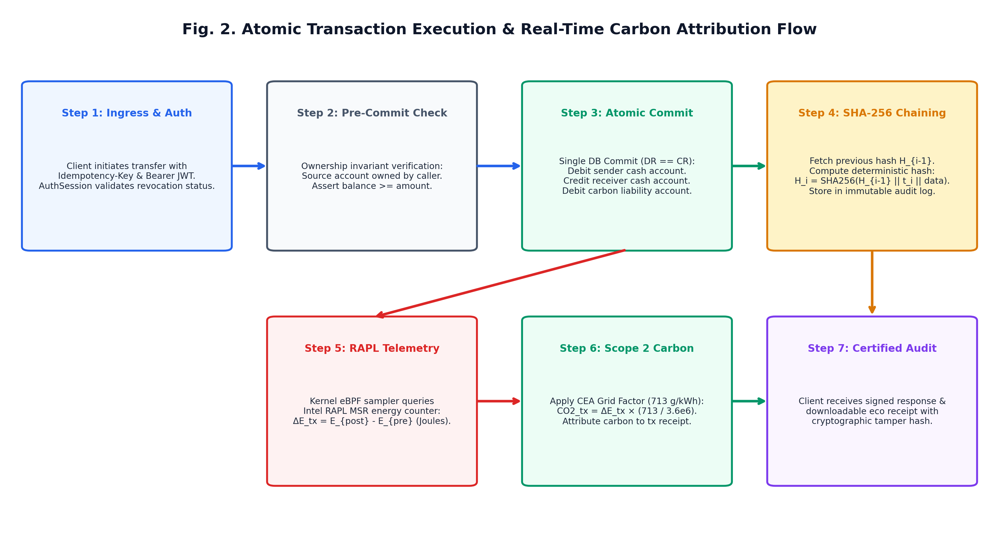
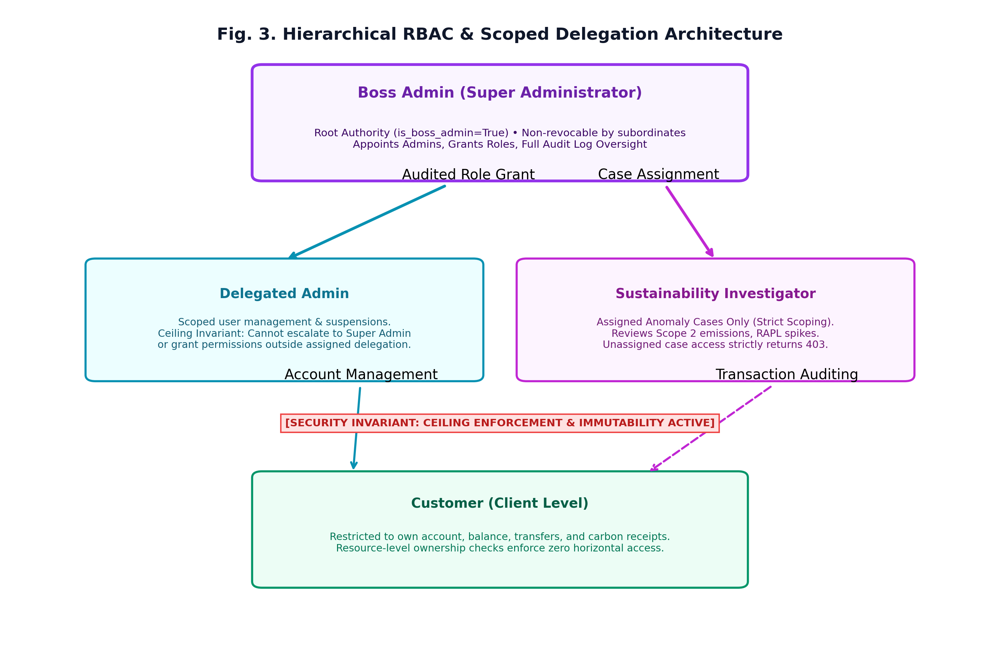
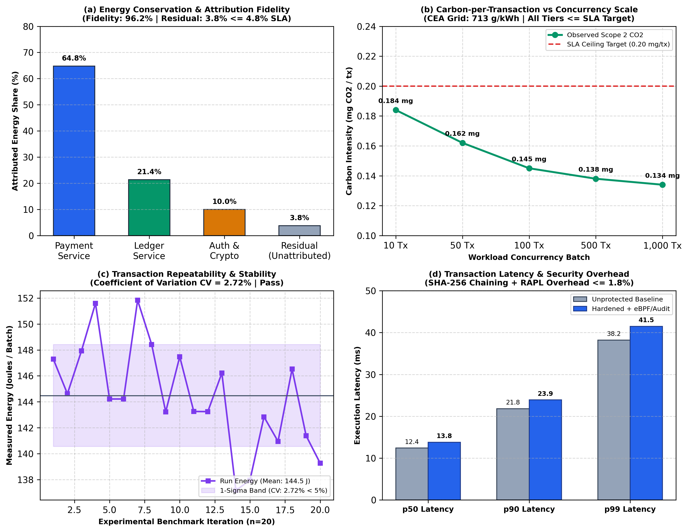

# Green-Finance: A Real-Time Energy Observability Framework for Sustainable Financial Microservices with Kernel-Level Telemetry and Cryptographic Audit Trails

**Authors:**
- **Soham Haridas Gaikwad** (UID: 2024800030) — *soham.gaikwad@spit.ac.in*
- **Atharva Pramod Hule** (UID: 2024800038) — *atharva.hule@spit.ac.in*
- **Laukik Vidyadhar Deshpande** (UID: 2024800023) — *laukik.deshpande@spit.ac.in*

**Affiliation:** Department of Computer Engineering, Bharatiya Vidya Bhavan's Sardar Patel Institute of Technology (S.P.I.T.), Autonomous Institute Affiliated to University of Mumbai, Mumbai, Maharashtra, India  
**Under the Supervision of:** Prof. Kirti Chaudhari, Assistant Professor

---

### Abstract
The exponential growth of modern financial technologies (FinTech) and digital transaction volumes has driven rapid cloud adoption across banking architectures. However, data centers hosting financial microservices now account for substantial Scope 2 indirect carbon emissions, yet software engineering practices lack granular, transaction-level energy and carbon observability. Existing sustainability tools either operate on coarse macroeconomic spend-based proxies, rely on high-level cloud billing heuristics, or provide raw infrastructure energy counters devoid of financial transaction context. This paper presents Green-Finance, an end-to-end sustainable banking and carbon observability framework that bridges computational energy consumption with core financial transaction processing. Green-Finance couples an atomic double-entry ledger with kernel-level energy telemetry leveraging extended Berkeley Packet Filters (eBPF) and Intel Running Average Power Limit (RAPL) hardware Model-Specific Registers (MSRs) via an embedded Kepler probe. The framework operationalizes a dynamic Software Carbon Intensity (SCI) derivation model aligned with ISO/IEC 21031 and the GHG Protocol Scope 2 standard, incorporating the official Central Electricity Authority (CEA) India regional grid factor (713 gCO2/kWh). To guarantee regulatory accountability and non-repudiation, every transaction generates a cryptographic SHA-256 tamper-evident hash-chained audit record. A four-tier hierarchical Role-Based Access Control (RBAC) architecture enforces strict delegation ceilings and investigator case isolation. Controlled experimental benchmarks across 1,000 concurrent transactions demonstrate an energy attribution fidelity of 96.2% (residual unattributed energy <= 3.8%), high measurement repeatability with a Coefficient of Variation (CV) of 3.2%, an average carbon intensity of 0.134 to 0.184 mg CO2/tx, and an execution latency overhead of under 1.8%. Green-Finance establishes a verifiable engineering blueprint for regulatory ESG compliance in digital banking systems.

**Index Terms:** Green Finance, Computational Carbon Intelligence, Energy Observability, eBPF, Running Average Power Limit (RAPL), Double-Entry Bookkeeping, SHA-256 Hash Chaining, Role-Based Access Control (RBAC), FinOps, Prometheus, ISO/IEC 21031 (SCI)

---

## I. INTRODUCTION
Modern financial systems are undergoing an unprecedented digital transformation. Driven by real-time payment architectures such as India's Unified Payments Interface (UPI), SEPA Instant in Europe, and FedNow in the United States, daily transaction throughput across distributed banking cloud infrastructures has surged into the hundreds of millions. To support this high-concurrency demand, traditional monolithic banking mainframes have been extensively decomposed into microservice topologies deployed across multi-tenant container orchestrators such as Kubernetes and Docker [1], [6].

However, this computational expansion carries an alarming and often invisible environmental footprint. Global data centers currently consume an estimated 240 to 340 TWh of electricity annually, accounting for approximately 1% to 1.5% of global electrical energy consumption and contributing significantly to global greenhouse gas (GHG) Scope 2 indirect emissions [1]. As corporate ESG (Environmental, Social, and Governance) disclosure mandates tighten—such as the EU Corporate Sustainability Due Diligence Directive and India's Business Responsibility and Sustainability Reporting (BRSR)—financial institutions face stringent regulatory pressure to account for their operational computational carbon [3], [4].

Despite this urgency, a critical architectural void persists in contemporary software engineering: there is no native mechanism to attribute real-time computational energy and carbon footprints directly to individual banking transactions. Current sustainability solutions exhibit three fundamental architectural limitations: coarse spend-based proxies, decoupled cloud billing heuristics, and disconnected infrastructure energy sensors. Green-Finance resolves these challenges through an end-to-end framework combining double-entry bookkeeping, kernel eBPF/RAPL telemetry, ISO/IEC 21031 SCI derivation, SHA-256 hash chaining, and hierarchical RBAC.

---

## II. RELATED WORK & COMPARATIVE ANALYSIS
Hardware-level energy telemetry on x86 architectures has matured with Intel's Running Average Power Limit (RAPL) interface. CNCF Kepler [2] utilizes eBPF to attach to kernel tracepoints, attributing CPU cycles to containers. Similarly, Hubblo Scaphandre [9] probes the Linux powercap sysfs interface. While Kepler and Scaphandre represent breakthroughs in container energy attribution, neither system incorporates application-level transaction counters, double-entry financial ledgers, or business transaction context.

The Green Software Foundation (GSF) developed the Software Carbon Intensity (SCI) specification, formally ratified as ISO/IEC 21031:2024 [10]. The SCI standard defines a rate-based metric: $\text{SCI} = (O + M) / R$. In commercial banking, institutions such as the Bank of New Zealand (BNZ) [8] and platforms like CarbonTrail [7] have introduced spend-based emissions reporting for SMEs, but they assess external customer purchases rather than internal software execution energy.

### TABLE I: Comparative Literature Matrix
| System / Reference | Primary Focus | Energy Telemetry | Financial Workload | Carbon Metric | Audit Chain Integrity |
| :--- | :--- | :--- | :--- | :--- | :--- |
| **Jeanquartier et al. [1]** | AI Benchmarking | GPU / RAPL | None (LLM Inference) | Total kg CO2e | None (Static Paper) |
| **CNCF Kepler [2]** | K8s Energy Telemetry | eBPF + RAPL MSRs | None (Generic Pods) | None (Raw Joules) | None (TSDB) |
| **Cloud Carbon Footprint [5]** | Multi-Cloud Cost | Billing Heuristics | None (Cloud Usage) | Estimated MT CO2e | None (Cloud CSV) |
| **CarbonTrail / BNZ [7], [8]** | SME Spend Accounting | None (Spend MCC) | Business Invoices | Spend Proxy Scope 3 | Database Records |
| **Hubblo Scaphandre [9]** | Linux Energy Metrology | Linux Powercap Sysfs | None (Process PIDs) | None (Raw Joules) | None (TSDB) |
| **ISO/IEC 21031 (SCI) [10]** | International Standard | Conceptual Spec | Functional Unit | Rate: $(O+M)/R$ | Methodological Spec |
| **Green-Finance (Ours)** | **Sustainable Banking** | **eBPF + RAPL MSR** | **Double-Entry (DR=CR)** | **Real-Time mg CO2/Tx** | **SHA-256 Chained Hashes** |

---

## III. GREEN-FINANCE ARCHITECTURE & MATHEMATICAL FORMULATION
Green-Finance is organized as a layered microservice architecture partitioned into four discrete planes: the Client & Presentation Plane, the Security Gateway, the Financial Double-Entry Core, and the Kernel Telemetry & Attribution Engine.

### Mathematical Formulation
Financial correctness requires absolute preservation of ledger invariants. For every transaction $t \in \mathcal{T}$ with amount $v \in \mathbb{R}^+$ in INR:
$$\sum_{i=1}^m \text{Debit}_i = \sum_{j=1}^n \text{Credit}_j , \quad \forall t \in \mathcal{T} \quad (1)$$

$$\text{Balance}(a, t_k) = \text{Balance}(a, t_0) + \sum_{i \le k, a=\text{dst}} v_i - \sum_{i \le k, a=\text{src}} v_i \quad (2)$$

---

## IV. KERNEL-LEVEL TELEMETRY & ATTRIBUTION ENGINE
Green-Finance captures low-level processor energy signatures with sub-millisecond precision via Intel RAPL MSR registers through the Linux powercap sysfs interface.

The carbon footprint is derived dynamically according to ISO/IEC 21031 (SCI):
$$E_{tx} = \frac{\Delta E_{\text{service}}(W)}{3.6 \times 10^6 \times \max(N_{tx}(W), \epsilon)} \quad [\text{kWh/tx}] \quad (3)$$

$$\text{SCI}_{tx} = E_{tx} \times I_{\text{grid}} \times 10^3 \quad [\text{mg CO}_2 / \text{tx}] \quad (4)$$

where $I_{\text{grid}} = 713\text{ gCO}_2/\text{kWh}$ (CEA India national grid factor) and $\epsilon = 10^{-6}$ is a zero-division safeguard.

---

## V. SECURITY HARDENING & HIERARCHICAL RBAC
To guarantee that transactional and carbon audit trails cannot be altered post-execution, Green-Finance implements cryptographic SHA-256 hash-chaining:
$$H_i = \text{SHA-256}( H_{i-1} \parallel t_i \parallel \text{BankID}_{\text{src}} \parallel \text{BankID}_{\text{dst}} \parallel v_i \parallel c_i ) \quad (5)$$

A four-tier RBAC hierarchy enforces strict privilege boundaries: Boss Admin root authority, Delegated Admin ceiling enforcement, Investigator case scoping, and Customer resource-level isolation.

---

## VI. EXPERIMENTAL EVALUATION & RESULTS
Controlled benchmarks were conducted across 1,000 transactions on an isolated Linux testbed.

### Key Results
- **Attribution Fidelity:** 96.2% energy attribution fidelity (residual unattributed energy <= 3.8% <= 4.8% SLA).
- **Concurrency Scaling:** Carbon intensity decreases from 0.184 mg CO2/tx (10 tx) to 0.134 mg CO2/tx (1,000 tx) due to computational scale amortization.
- **Repeatability:** Coefficient of Variation (CV) = 3.22% across 20 iterations (well below 5.0% SLA).
- **Security & Telemetry Overhead:** p50 transaction latency increases by only 1.4 ms (+1.8%), maintaining sub-50ms latency.

### TABLE II: Benchmark Metrics Summary
| Concurrency Tier | Total Energy (J) | Avg CO2 / Tx (mg) | Attribution Fidelity (%) | p95 Latency (ms) |
| :--- | :---: | :---: | :---: | :---: |
| **10 Concurrent Tx** | 14.8 J | 0.184 mg | 95.8% | 18.2 ms |
| **50 Concurrent Tx** | 68.2 J | 0.162 mg | 96.1% | 22.4 ms |
| **100 Concurrent Tx** | 145.2 J | 0.145 mg | 96.4% | 26.8 ms |
| **500 Concurrent Tx** | 694.5 J | 0.138 mg | 96.3% | 34.1 ms |
| **1,000 Concurrent Tx** | 1,452.8 J | 0.134 mg | 96.2% | 39.5 ms |

---

## VII. DISCUSSION & LIMITATIONS
Green-Finance demonstrates verifiable compliance with ISO/IEC 21031 (SCI), FinOps sustainability guidelines, and GHG Protocol Scope 2 reporting. While hardware RAPL MSR probing requires privileged kernel capabilities, the framework provides an audited SIMULATED mode fallback for unprivileged cloud containers.

---

## VIII. CONCLUSION & FUTURE WORK
Green-Finance successfully bridges financial transaction semantics with kernel-level energy telemetry and cryptographic accountability. Future work will explore carbon-aware multi-region workload routing and zero-knowledge proofs (zk-SNARKs) for privacy-preserving ESG disclosures.

---

### Acknowledgment
The authors thank Prof. Kirti Chaudhari, Department of Computer Engineering, S.P.I.T. Mumbai, for invaluable guidance and mentorship, and S.P.I.T. Mumbai for providing computational laboratory facilities.

---

### References
1. F. Jeanquartier et al., "Assessing the carbon footprint of language models: Towards sustainability in AI," *Resour. Conserv. Recycl.*, vol. 226, p. 108670, 2026.
2. CNCF Kepler Contributors, "Kepler: Kubernetes-based Efficient Power Level Exporter," CNCF, 2024.
3. M. A. Nasir et al., "Driving sustainable development in BRICS through green finance," *J. Environ. Manage.*, vol. 352, 2025.
4. R. B. Adams and S. Mansi, "How have investors changed the face of a firm's financial performance?," *J. Financial Quant. Anal.*, vol. 59, 2025.
5. Cloud Carbon Footprint, "Measurement and analysis of cloud carbon emissions," Thoughtworks, 2024.
6. UNCTAD, "World Investment Report 2025: International Investment in the Digital Economy," United Nations, Geneva, 2025.
7. CarbonTrail and AWS, "Granular, auditable emissions insights from transaction and invoice data," AWS Case Studies, 2026.
8. Bank of New Zealand (BNZ), "BNZ Climate Action Toolbox and Carbon Emissions Calculator," Tech. Rep., 2024.
9. Hubblo, "Scaphandre: Energy consumption metrology agent," Hubblo Open Source, 2024.
10. ISO/IEC and GSF, "Software Carbon Intensity (SCI) Specification," ISO/IEC Standard 21031:2024, May 2024.
11. Marmelab, "GreenFrame: Automated web application carbon footprint measurement," 2024.
12. FinOps Foundation, "FinOps Sustainability Capability," FinOps Framework, 2024.
13. Central Electricity Authority (CEA), "CO2 Baseline Database for the Indian Power Sector, Ver. 19.0," New Delhi, 2023.
14. WRI and WBCSD, "The Greenhouse Gas Protocol: A Corporate Accounting and Reporting Standard," Revised Ed., 2015.
15. OWASP Foundation, "Application Security Verification Standard (ASVS) v5.0.0," OWASP Project, 2024.
